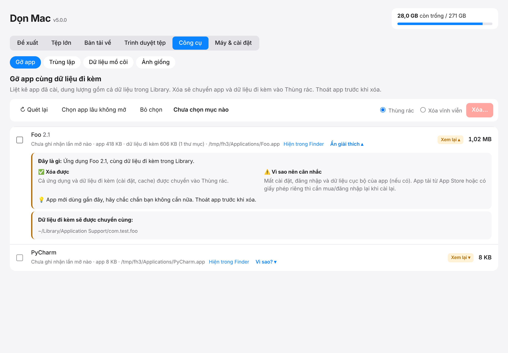

# Spotless Mac

Công cụ dọn dung lượng cho macOS, chạy hoàn toàn trên máy bạn. Một file Python duy nhất (chỉ dùng thư viện chuẩn), giao diện giống mục **Dung lượng** của macOS, có xem trước ảnh/tài liệu và giải thích "nên hay không nên xóa" cho từng mục.

- Không gửi dữ liệu ra ngoài, không cần mạng. Máy chủ chỉ nghe trên `127.0.0.1` với mã bí mật ngẫu nhiên mỗi lần chạy.
- Mặc định **chuyển vào Thùng rác**; xóa vĩnh viễn chỉ khi bạn chọn.
- Chỉ xóa được những mục chính app vừa quét ra (API chỉ nhận id do app cấp, không nhận đường dẫn tùy ý).



## Cài đặt (macOS)

```bash
python3 src/don_mac.py --install
```

Lệnh này biên dịch app gốc `Spotless Mac.app` vào thư mục Ứng dụng (cần Xcode Command Line Tools: `xcode-select --install`). Mở bằng Spotlight rồi bật **Toàn quyền truy cập ổ đĩa** cho Spotless Mac một lần là app không hỏi quyền nữa. Cập nhật code sau này chỉ cần chạy lại lệnh trên; quyền đã cấp được giữ nguyên.

Chạy thử không cần cài: `python3 src/don_mac.py`.

## Tính năng

| Tab | Làm gì |
|---|---|
| **Đề xuất** | Gom mọi thứ dọn được: cache, nhật ký, file cài đặt, Docker/OrbStack, Xcode & công cụ lập trình, simulator, thư mục build của dự án (`node_modules`, Rust `target`, `Pods`, `.next`, `.dart_tool`, `build`…), Thùng rác… mỗi mục có nhãn **An toàn / Xem lại / Cẩn thận** kèm lời giải thích. |
| **Tệp lớn**, **Bản tải về**, **Trình duyệt tệp** | Bảng kiểu macOS, xem trước ảnh/PDF/video/văn bản, Quick Look bằng Space. |
| **Công cụ → Gỡ app** | Gỡ app cùng dữ liệu đi kèm trong Library. |
| **Công cụ → Trùng lặp** | File giống hệt nội dung (so bằng SHA-256); luôn giữ lại ít nhất một bản. |
| **Công cụ → Dữ liệu mồ côi** | Dữ liệu trong Library của app đã gỡ. |
| **Công cụ → Ảnh giống** | Ảnh trông giống nhau (băm cảm nhận qua `sips`), chỉ để bạn tự chọn; có ô chọn cả nhóm và nút “Chọn tất cả trừ ảnh lớn nhất mỗi nhóm”. |
| **Công cụ → Dấu vết AI** | File thừa của Claude Code, Claude Desktop, Codex, ChatGPT: phiên bản cũ sau mỗi lần tự cập nhật, transcript/nhật ký/ảnh cũ theo số ngày, máy ảo Cowork, cache của app. File cấu hình, đăng nhập, `CLAUDE.md` và `memory/` không bao giờ bị đụng tới. |
| Nên xóa khi nào | Mọi lời khuyên có thêm mục “🕒 Nên xóa khi nào”; thư mục Electron/Chromium quen thuộc (CertificateRevocation, Crashpad, ShaderCache…) được giải thích cụ thể |
| **Hoạt động** | Như Giám sát hoạt động nhưng có giải thích: app/tiến trình nào ngốn RAM, CPU nhiều nhất (gom helper về app chủ), Áp lực bộ nhớ, phát hiện tiến trình bị kẹt (ví dụ `crashpad_handler` ăn 100%+ CPU), vì sao tốn và nên đóng khi nào. Với Brave/Chrome/Edge/Arc/Safari: liệt kê tab, xếp hạng tab nặng nhất (ước tính hoặc đo chính xác), chuyển tới hoặc đóng tab ngay. Không bao giờ cho buộc dừng tiến trình hệ thống. |
| **Pin & tối ưu** | Pin & sạc (củ sạc cấp bao nhiêu W so với máy đang dùng, cảnh báo pin tụt khi cắm sạc, app tốn điện nhất theo “Tác động năng lượng”, sức khỏe pin); Kiểm tra nhanh (Tiết kiệm bộ nhớ/tăng tốc phần cứng/chạy nền của Brave–Chrome–Edge, tiện ích nặng hoặc thừa, app chạy từ Tải về, Chế độ nguồn điện thấp, nên khởi động lại); Khởi động cùng máy (tắt/bật LaunchAgent có sao lưu, bỏ/thêm app mở khi đăng nhập); Theo dõi nền mỗi phút (báo tiến trình kẹt, tự buộc dừng crashpad, pin tụt, thiếu RAM) và biểu tượng trên thanh menu; Lịch sử ổ đĩa/RAM/pin, dự báo ngày đầy ổ, ổ đầy vì đâu, đã dọn theo tuần. |
| **Công cụ → Dọn sâu (lập trình)** | Mổ xẻ Gradle (thư viện, build cache, transforms, bản Gradle cũ), Android SDK (system image, NDK, build-tools, platform cũ), snapshot máy ảo Android, image Docker/OrbStack không dùng, cache npm/pnpm/yarn/bun/pip/uv/Poetry/CocoaPods/Rust, bản Python pyenv, và gom node_modules/venv quá 4 tháng không đụng tới. |
| **Pin & tối ưu → Nhiệt độ** | Máy có đang bị macOS hạ xung CPU vì nóng không (tốc độ CPU %, số nhân bị khóa, kernel_task), nhiệt độ pin, app đang đốt CPU và cách hạ nhiệt. |
| **Pin & tối ưu → Mạng** | App nào đang tải lên/xuống nhiều nhất (tốc độ theo giây và tổng từ lúc mở), kèm lý do thường gặp: đồng bộ iCloud/Drive, container đang pull, tab video. |
| **Pin & tối ưu → Quyền riêng tư** | Liệt kê app đang có quyền Camera, Micro, Ghi màn hình, Trợ năng, Theo dõi bàn phím, Toàn quyền ổ đĩa…; đánh dấu app đã gỡ nhưng còn quyền; mở thẳng trang cài đặt tương ứng (chỉ đọc, không tự sửa quyền). |
| **Pin & tối ưu → Hoàn tác** | Gom theo từng lần dọn; một nút đưa mọi file của lần đó từ Thùng rác về đúng chỗ cũ, bỏ qua mục đã rời Thùng rác hoặc chỗ cũ đã có tệp khác. |
| **Máy & cài đặt** | Dọn tự động theo lịch, danh sách **Luôn giữ**, lịch sử dọn dẹp, trạng thái máy, mục tự khởi động, bảo mật cơ bản (chỉ xem). |

### Dòng lệnh

```bash
python3 src/don_mac.py --auto-clean --dry-run --min-mb 200   # xem trước
python3 src/don_mac.py --auto-clean --min-mb 200             # dọn các mục An toàn
```

`--auto-clean` chỉ chạm nhóm bộ nhớ đệm, nhật ký, file cài đặt đã cài app và cache công cụ, mức **An toàn**, bỏ qua mục trong danh sách Luôn giữ và ghi vào lịch sử.

## An toàn dữ liệu

- Vùng bảo vệ (thư mục nhà, Documents, Keychains, `.ssh`…) không bao giờ xóa được.
- Mục trong **Luôn giữ**, và thư mục chứa chúng, không xóa được bằng bất kỳ đường nào.
- Spotless Mac không đổi cài đặt hệ thống và không phải phần mềm diệt virus; phần bảo mật chỉ hiển thị trạng thái.
- Một số thao tác luôn xóa vĩnh viễn (Docker, Homebrew, simulator, snapshot Time Machine): app báo rõ trước khi xóa.

## Kiểm thử

Chạy được trên Linux hoặc macOS với thư mục nhà giả (cần Node + Playwright cho kiểm thử giao diện):

```bash
python3 tests/make_fake_home.py /tmp/fh
HOME=/tmp/fh python3 tests/test_core.py
HOME=/tmp/fh python3 tests/test_advice.py
python3 tests/test_activity.py
FAKE_HOME=/tmp/fha node tests/ui_activity.js
HOME=/tmp/fho python3 tests/test_optim.py
FAKE_HOME=/tmp/fhp node tests/ui_optim.js
HOME=/tmp/fhd python3 tests/test_deep.py
FAKE_HOME=/tmp/fhq node tests/ui_deep.js
HOME=/tmp/fh python3 tests/test_tools.py
node tests/ui_smoke.js                                   # đặt FAKE_HOME=/tmp/fh
python3 tests/seed_tools_home.py /tmp/fh3 && FAKE_HOME=/tmp/fh3 node tests/ui_tools.js
```

Các phần chỉ kiểm được trên máy Mac thật: `mdls`, `qlmanage`, `sips`, biên dịch Swift, `launchctl`, lệnh bảo mật.

## Cấu trúc

```
src/don_mac.py     toàn bộ ứng dụng (server, giao diện nhúng, trình cài app)
tests/             kiểm thử
specs/             đặc tả theo Spec Kit: 001 duyệt tệp + xem trước, 002 lời khuyên, 003 bộ công cụ mở rộng
.specify/          hiến pháp dự án và mẫu Spec Kit
```

## Giấy phép

MIT, xem [LICENSE](LICENSE).
